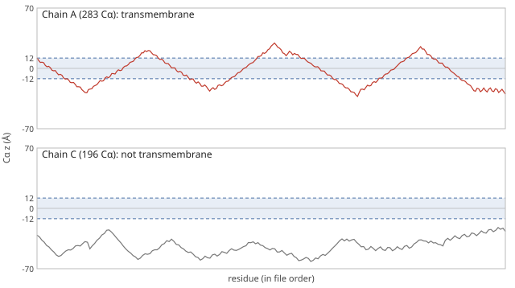

# Membrane frame and chain selection

MemProt2D does not orient structures in the membrane itself. It reads
coordinates that are already in a membrane frame, and uses that frame to decide
which chains cross the bilayer and which one to draw first
([`src/orientation/transmembrane.ts`](../src/orientation/transmembrane.ts)).

## The membrane frame

In the membrane frame the bilayer normal is the z axis and z = 0 is the bulk
midplane. Two sources provide structures in this frame:

- **OPM** ([Lomize et al., 2006](https://doi.org/10.1093/bioinformatics/btk023);
  [2012](https://doi.org/10.1093/nar/gkr703)) positions each PDB entry with the
  PPM method, which minimises the protein's transfer energy from water into an
  implicit hydrophobic slab. The [examples](../examples/README.md) and the demo
  use OPM coordinates.
- **MemProtMD** ([Newport, Sansom & Stansfeld,
  2019](https://doi.org/10.1093/nar/gky1047)) self-assembles a coarse-grained
  DPPC bilayer around each protein and keeps the simulation-box frame, with the
  midplane at the box's bilayer height rather than z = 0. A distortions file
  gives that height, and the component shifts the structure onto it; see
  [membrane.md § Frames](membrane.md#frames).

A structure in an arbitrary crystal frame is drawn as given, so the diagram's
"membrane" is then meaningless. Orienting such a structure in the browser
(for example with a hydrophobic-slab fit, as in PPM or
[TMDET](https://doi.org/10.1093/bioinformatics/bth340)) is not implemented.

## Which chains are transmembrane

A chain is **transmembrane** if at least one Cα reaches the upper edge of the
membrane core and at least one reaches the lower edge (`isTransmembrane`). The
core edges sit 8 Å inside each bulk leaflet's headgroup surface
(`membraneCore` in [`src/membrane/model.ts`](../src/membrane/model.ts)): ±12 Å
for the default ±20 Å leaflets, which is inside the hydrophobic core of a DPPC
bilayer (OPM's hydrophobic half-thicknesses are typically 12–15 Å). A test on
the extreme Cα, rather than on assigned transmembrane segments, needs no
secondary structure and works for helices, barrels and irregular chains alike.
Its weakness is that one deep re-entrant loop or a single amphipathic helix
lying in an interface cannot reach both edges, so such chains are correctly
excluded, but a chain whose only crossing is unresolved in the structure is
excluded too.

_Figure 1. Cα height (Å, OPM frame) along each chain of 5G53. Chain A, the
adenosine A2A receptor, crosses the shaded core (±12 Å) seven times and is
transmembrane. Chain C, the mini-Gs partner, stays below the bilayer
and is not. Generated by
[`scripts/docs-figures.ts`](../scripts/docs-figures.ts) from
[`examples/5g53.pdb`](../examples/5g53.pdb)._

## Which chain is drawn first

`selectTransmembraneChains` sorts chains by residue count (largest first),
keeps the transmembrane ones and returns the first. For a homo-oligomer such as
the OmpF trimer or the α-hemolysin heptamer that is one representative copy;
for 5G53 it drops the soluble partner. If no chain is transmembrane it falls
back to the largest chain overall and reports that it did
(`fellBackToLargest`). A `selection` attribute naming a chain overrides the
choice, and the chain picker ([chain-icons.md](chain-icons.md)) lets the user
switch.

## References

- Lomize MA, Lomize AL, Pogozheva ID, Mosberg HI (2006). OPM: Orientations of
  Proteins in Membranes database. _Bioinformatics_ 22(5):623–625.
  https://doi.org/10.1093/bioinformatics/btk023
- Lomize MA, Pogozheva ID, Joo H, Mosberg HI, Lomize AL (2012). OPM database
  and PPM web server: resources for positioning of proteins in membranes.
  _Nucleic Acids Res._ 40(D1):D370–D376. https://doi.org/10.1093/nar/gkr703
- Newport TD, Sansom MSP, Stansfeld PJ (2019). The MemProtMD database: a
  resource for membrane-embedded protein structures and their lipid
  interactions. _Nucleic Acids Res._ 47(D1):D390–D397.
  https://doi.org/10.1093/nar/gky1047
- Tusnády GE, Dosztányi Z, Simon I (2004). Transmembrane proteins in the
  Protein Data Bank: identification and classification. _Bioinformatics_
  20(17):2964–2972. https://doi.org/10.1093/bioinformatics/bth340
