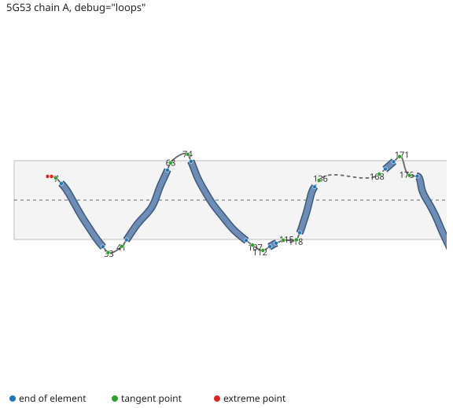

# Loop placement

In the 2-D topology every helix and strand keeps its real shape: its arc
length along the membrane plane and its height z are those of its smoothed
axis ([rendering.md](rendering.md)). Loops are treated differently. Their
horizontal extent is fixed and only their vertical excursion is kept. The code
is in [`src/layout/segments.ts`](../src/layout/segments.ts) (`layoutSegments`)
and [`src/layout/loops.ts`](../src/layout/loops.ts) (`buildLoopPoints`), with
the constants in `LOOP` in [`src/layout/constants.ts`](../src/layout/constants.ts).

## Fixed gaps between elements

The unrolled chain is cut into secondary-structure runs. Each helix or strand
is shifted along the arc axis so that it starts exactly `LOOP.elementGapPx`
(30 px, 12 Å at the 2.5 px/Å scale) after the previous element ends, measured
from the end of one element's axis to the start of the next. Inside an element
the arc geometry is unchanged; only the offset between elements changes. A
chain break gets the same gap.

The reason is the shape of the data. In an unrolled membrane protein the
transmembrane elements carry the information (tilt, kink, length), while loop
lengths vary from 2 to over 100 residues. Giving each loop its real arc length
would make a long extracellular domain push the transmembrane helices far
apart and leave short turns unreadable. Snake-plot tools such as
[TMRPres2D](https://doi.org/10.1093/bioinformatics/bth358) and
[Protter](https://doi.org/10.1093/bioinformatics/btt607) take the other
approach: one bead per residue, so a loop's drawn length is its residue count,
and no element geometry is kept at all. MemProt2D keeps the element geometry
and gives every loop the same width, so the eye compares elements, not loops.
The loop's residues and length remain available in the sequence view
([sequence-view.md](sequence-view.md)).

## The loop curve

Each loop is drawn as a curve through up to six control points, in (arc, z):

| Point | Where                                                                   |
| ----- | ----------------------------------------------------------------------- |
| 1     | The end of the previous element's axis.                                 |
| 2     | Point 1 moved `LOOP.tangentMagPx` (10 px) along that element's tangent. |
| 3, 4  | Two **extreme points**, only when needed (below).                       |
| 5     | Point 6 moved 10 px back along the next element's start tangent.        |
| 6     | The start of the next element's axis.                                   |

Points 2 and 5 make the loop leave and enter each element in line with it, so a
tilted helix does not appear to bend at its end. A loop at either end of the
chain has only one element and so only points 1–2 or 5–6. The curve is a
centripetal Catmull–Rom spline through the points ([Yuksel, Schaefer & Keyser,
2011](https://doi.org/10.1016/j.cad.2010.08.008)), drawn as exact cubic Bézier
pieces. The centripetal parameterisation (α = ½) cannot form cusps or
self-intersections within a span, which matters here because the tangent
points sit close to the end points.

**Extreme points.** A loop that dips far below or rises far above its two
elements, such as a long intracellular loop, would be flattened by a curve
through points 1, 2, 5 and 6 alone. So the loop's real path (the unrolled Cα
between the two elements) is scanned for its highest and lowest z. If it goes
beyond the z-range of the four tangent and end points by more than
`LOOP.extremeThreshold` (0.2) of that range, two points are added at the
extreme z, 5 px apart and centred in the gap. The pair gives the curve a short
flat at the true excursion. Only the larger of the two overshoots is used.
`loop-extremes="off"` turns this off and `loop-extreme-threshold` changes the
fraction ([attributes.md](attributes.md)).

_Figure 1. The first four transmembrane helices of the A2A receptor (5G53
chain A) with `debug="loops"`, which marks each loop's control points: element
ends (blue), tangent points (green) and extreme points (red). Every loop spans
the same width. The N-terminal stub before residue 7 has points 5–6 and an
extreme pair. The dashed curve between 141 and 168 crosses a chain break
(residues 147–158 are missing from the structure). Generated by
[`scripts/docs-figures.ts`](../scripts/docs-figures.ts)._

## Limitations

- A loop's drawn height is its true extreme, but its drawn width carries no
  information. A loop whose path wanders sideways in the membrane plane is
  drawn as the same simple arch.
- The extreme pair records one excursion. A loop that dips below the membrane
  and then rises above it shows only the larger of the two.
- β-barrel hairpins use the same construction with longer tangent handles
  (`BARREL.loopTangentPx`, 14 px), so they lean with the strands; see
  [beta-barrels.md](beta-barrels.md).

## References

- Yuksel C, Schaefer S, Keyser J (2011). Parameterization and applications of
  Catmull–Rom curves. _Computer-Aided Design_ 43(7):747–755.
  https://doi.org/10.1016/j.cad.2010.08.008
- Spyropoulos IC, Liakopoulos TD, Bagos PG, Hamodrakas SJ (2004). TMRPres2D:
  high quality visual representation of transmembrane protein models.
  _Bioinformatics_ 20(17):3258–3260.
  https://doi.org/10.1093/bioinformatics/bth358
- Omasits U, Ahrens CH, Müller S, Wollscheid B (2014). Protter: interactive
  protein feature visualization and integration with experimental proteomic
  data. _Bioinformatics_ 30(6):884–886.
  https://doi.org/10.1093/bioinformatics/btt607
