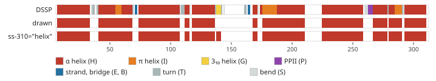

# Secondary structure: source, classes and minimum length

`<topology-display>` draws three kinds of element: helices, strands and coil.
This note covers where the assignment comes from, which DSSP classes map to
which element, and the minimum length below which an element is drawn as coil.

## Source

Secondary structure comes from DSSP ([Kabsch & Sander,
1983](https://doi.org/10.1002/bip.360221211)), which assigns each residue one
of eight classes from its backbone hydrogen bonds (and, for polyproline II,
its φ/ψ angles). The component reads DSSP's mmCIF output
([`parseDsspMmcif`](../src/parser/dssp-mmcif.ts)), not the HELIX/SHEET records
of the coordinate file: `parsePdb` reads only Cα atoms.

- The demo and the [examples](../examples/README.md) use `*.dssp.cif` files
  downloaded from [PDB-REDO's DSSP
  service](https://pdb-redo.eu/dssp) ([Joosten et al.,
  2014](https://doi.org/10.1107/S2052252514009324)), which runs DSSP 4
  ([Hekkelman et al., 2025](https://doi.org/10.1101/2025.04.11.648460)).
- `<topology-loader>` fetches the same service's mmCIF for the PDB entry
  at load time.

Either way DSSP is computed on the **deposited** structure, while the
coordinates drawn are OPM's (demo) or MemProtMD's after simulation (loader).
Helix ends and short strands can differ between the two, and MemProtMD's
numbering is mapped back to the deposited one first (`mapToDeposited`).
Computing DSSP in the browser on the drawn coordinates is planned (#79) but
not implemented.

## Class mapping

DSSP 4 writes helices, PPII stretches, turns and bends as rows of
`_struct_conf`, keyed by `conf_type_id`, and strands as rows of
`_struct_sheet_range`. [`isHelixConfType`](../src/parser/dssp-mmcif.ts) decides
which `_struct_conf` rows become helices; every `_struct_sheet_range` row
becomes a strand.

| DSSP class       | Letter | mmCIF record                                 | Drawn as                          |
| ---------------- | ------ | -------------------------------------------- | --------------------------------- |
| α helix          | H      | `_struct_conf` `HELX_RH_AL_P`                | helix                             |
| π helix          | I      | `_struct_conf` `HELX_RH_PI_P`                | helix                             |
| 3₁₀ helix        | G      | `_struct_conf` `HELX_RH_3T_P`                | coil; helix with `ss-310="helix"` |
| polyproline II   | P      | `_struct_conf` `HELX_LH_PP_P`                | coil                              |
| strand           | E      | `_struct_sheet_range`                        | strand                            |
| isolated bridge  | B      | `_struct_sheet_range` (one-residue range)    | strand, then dropped as too short |
| turn, bend, none | T, S   | `_struct_conf` `TURN_TY1_P`, `BEND`, `OTHER` | coil                              |
| generic helix    | –      | `_struct_conf` `HELX_P`                      | helix (files from other programs) |

The reasons:

- **π with α.** Since version 2.1 DSSP gives π helices priority over α,
  following [Cooley, Arp & Karplus
  (2010)](https://doi.org/10.1016/j.jmb.2010.09.034), who argued that π helices
  arise as one-residue insertions (π-bulges) in α helices. Drawn
  separately, each one would split a transmembrane helix into three elements.
  5G53 chain A has three: 55–59, 176–187 and 285–290.
- **3₁₀ off by default.** 3₁₀ helices are short (DSSP's shortest is three
  residues) and often sit at a helix end or in a loop, so drawn as helices
  they add stubs next to the real helix; 5G53 chain A's only one, 138–141,
  follows the helix 118–136 after a one-residue turn. `ss-310="helix"` on `<topology-loader>`, or
  `parseDsspMmcif(text, { helix310: true })`, draws them.
- **PPII as coil.** Polyproline II is a left-handed, extended conformation with
  no backbone hydrogen bonds along it: a loop conformation, not a helix in a
  topology diagram. DSSP has assigned it since version 4.0, under a
  `HELX_` type id, which is why the parser lists helix types explicitly rather
  than taking every `HELX_` row.
- **Bridges.** DSSP writes an isolated β-bridge as a one-residue sheet range.
  The parser keeps it as a strand and the minimum strand length (below)
  removes it; at `min-strand-length="1"` it is drawn.



_Figure 1. 5G53 chain A. Top: each residue coloured by its DSSP class. Middle:
the elements drawn by default. Bottom: with `ss-310="helix"`. The three π
stretches sit inside transmembrane helices and are drawn as part of them; the
PPII stretch 263–266 in ECL3 is coil; the 3₁₀ helix 138–141 is drawn only with
`ss-310="helix"`, as a separate four-residue helix after a one-residue turn.
Generated by [`scripts/docs-figures.ts`](../scripts/docs-figures.ts) from
[`examples/5g53.dssp.cif`](../examples/5g53.dssp.cif)._

DSSP's mmCIF also lists the hydrogen-bonded strand ladders
(`_dssp_struct_ladder`). These are not read: which strands pair is
re-derived from Cα spacing ([beta-barrels.md § 2](beta-barrels.md)).

## Minimum helix and strand length

DSSP often reports helices and strands only a few residues long. Drawn as
separate elements, they break a loop into short stubs, so `<topology-display>` treats any helix or
strand shorter than a minimum as coil.

| Attribute           | Default | Meaning                                          |
| ------------------- | ------- | ------------------------------------------------ |
| `min-helix-length`  | 4       | Shortest helix, in residues, drawn as a helix.   |
| `min-strand-length` | 4       | Shortest strand, in residues, drawn as a strand. |

Values are whole residue counts; invalid or negative values fall back to the
default, and `0` or `1` keeps every assignment. Changing either attribute
redraws the chain, keeping the scroll position and 3-D view.

```html
<topology-display min-helix-length="6" min-strand-length="5"></topology-display>
```

## Where the filter applies

The filter runs once on each chain's segments, before anything else reads
them, so every part of the component sees the same elements:

- **β-barrel detection** ([beta-barrels.md](beta-barrels.md)), for single
  chains and multi-chain assembly barrels. A higher `min-strand-length` can
  drop strands from the sheet and so change the strand count, the shear
  number, or whether a barrel is detected at all.
- the 2-D diagram, the helix and strand counts in the chain label, and the 3-D
  view;
- the chain-picker icons.

On the gallery proteins (3K19, 2OMF, 2J1N, 5G53, 7AHL) raising the default
from 3 to 4 changes no barrel result; it drops one 3-residue helix each from
3K19 and 2J1N.

## DSSP on the drawn structure

`<topology-loader>` draws a MemProtMD simulation's `at.pdb`, which is not the
deposited model: its atoms have moved during the simulation. PDB-REDO's DSSP
describes the deposited model, so its helix ends and strands can
disagree with the coordinates on screen. The loader therefore computes DSSP
itself on `at.pdb`'s backbone ([`src/secondary-structure/`](../src/secondary-structure/)),
and uses PDB-REDO's file only to put the residues back into the deposited
chains and numbering. `ss-source="pdb-redo"` restores the file's assignment.

`computeDssp` follows DSSP 4 (the program PDB-REDO runs): backbone H-bond
energies with the amide H placed from the previous carbonyl, the two best
acceptors per N–H, bridges between residues whose Cα are within 9 Å, ladders
joined across β-bulges, and α, 3₁₀ and π helices with π taking priority over
α. It assigns H, G, I, E and B only; turns, bends and polyproline II, which
are drawn as coil anyway, are left out. `structureSecondaryStructure` turns
the codes into segments as `parseDsspMmcif` does (3₁₀ only with `ss-310`) and
returns the ladders for strand pairing ([beta-barrels.md](beta-barrels.md)).

Validation against PDB-REDO's files:

| Input                                           | Residues with the same code                    |
| ----------------------------------------------- | ---------------------------------------------- |
| OPM coordinates of 3K19, 2OMF, 2J1N, 5G53, 7AHL | 100% (H/G/I/E/B), ladders identical            |
| MemProtMD `at.pdb` of 2J1N, 2OMF, 3K19, 5G53    | 98.9%, 99.9%, 98.3%, 95.4% (helix/strand/coil) |

The differences on `at.pdb` are the simulation's: helix ends that unwind or
extend by a residue or two, and short strands at loop tips. The computation
takes 40–300 ms for these structures.

A Cα-only file has no backbone to compute on: the loader then falls back to
PDB-REDO's assignment, and shows an error if that can't be fetched.
